# Nebulyx Lead Intelligence & Sellbird CRM — Production Deployment Guide

> **Technology, Thoughtfully Engineered.**  
> Complete deployment playbook for running the autonomous Instagram Reel scraper, Sellbird sales engine, and real-time CRM dashboard 24/7.

---

## 🏗️ Architecture Overview

The Nebulyx deployment stack consists of three coordinated tiers:

```mermaid
flowchart LR
    subgraph DataSources["Instagram Marketplace"]
        R["Reels Video Stream"]
        D["Google Dork Matrix"]
        H["Demand Hashtags"]
        E["Explore Grid"]
    end

    subgraph CoreEngine["Nebulyx Host / Container"]
        Playwright["Playwright Headless Edge/Chromium\n(Multi-Account Session Auth)"]
        Scout["Multimodal Scout + Agent-Reach\n(WinRT OCR + Gemini 3 Flash Vision)"]
        Sellbird["Sellbird Buyer Intent Gate\n& 3-Touch Sequence Generator"]
        Storage["JSON & CSV Lead Ledger\n(scraped_leads.json)"]
        Server["Threaded HTTP Server (Port 8088)\nCORS + REST + Settings API"]
    end

    subgraph ClientInterfaces["Access Points"]
        Web["Desktop Web Dashboard\n(http://localhost:8088)"]
        Mobile["Mobile Web CRM\n(Secure Cloudflare HTTPS Tunnel)"]
        WhatsApp["1-Click WhatsApp Dispatch\n(wa.me API)"]
    end

    DataSources --> Playwright
    Playwright --> Scout
    Scout --> Sellbird
    Sellbird --> Storage
    Storage <--> Server
    Server --> Web
    Server --> Mobile
    Mobile --> WhatsApp
    Web --> WhatsApp
```



---

## 🚀 Option 1: 1-Click Local Production Runner (Recommended)

> **Why Local is Best for Instagram:** Instagram heavily flags datacenter IP ranges (AWS, DigitalOcean, Vercel). Running on your desktop machine uses your residential IP for your configured Instagram account session, reducing risk of checkpoints or rate limits.

### Initial Bootstrap (Fresh Clone)
```bash
pip install -r requirements.txt
playwright install chromium
python lead_scraper/clean_leads_db.py
```

### Quick Start
Simply double-click the included batch launcher:
```text
start_nebulyx_production.bat
```

This script will:
1. Validate Python and Playwright installation.
2. Confirm the active authenticated session (`lead_scraper/auth_state.json`).
3. Boot the local production server on port `8088`.
4. Automatically launch `http://localhost:8088/dashboard.html` in your browser.

---

## 🐳 Option 2: Docker & Docker Compose Deployment (Cloud VPS)

For deploying to an Ubuntu/Debian VPS (e.g. Hetzner, DigitalOcean, AWS EC2):

### 1. Build and Run Container
```bash
# Clone or copy project to VPS
cd openhigsfield

# Build and start the container in detached mode
docker compose up -d
```

### 2. Verify Container Health
```bash
docker ps
# Check logs
docker logs -f nebulyx_lead_crm
```

### 3. Data Persistence
The `docker-compose.yml` mounts local files to ensure data persistence:
- `./lead_scraper/scraped_leads.json` ➔ Persists discovered leads.
- `./lead_scraper/scraped_leads.csv` ➔ Exports ready for CRM ingestion.
- `./lead_scraper/auth_state.json` ➔ Maintains authenticated Instagram session.

---

## 📱 Option 3: Remote Mobile Access via Cloudflare Tunnel (Free HTTPS)

To access your CRM dashboard and trigger 1-click WhatsApp pitches from your smartphone while away from your desk:

### Quick Launcher (Windows)
Double-click:
```text
expose_public_tunnel.bat
```

### Manual Command
```powershell
cloudflared tunnel --url http://localhost:8088
```

You will receive an instant, secure public HTTPS URL (e.g. `https://nebulyx-leads.trycloudflare.com/dashboard.html`). Open this on your mobile browser to manage your leads and dispatch WhatsApp pitches with a single tap.

---

## ⏱️ 24/7 Autonomous Background Scraping Daemon

To have the agent autonomously scour Instagram every 45 minutes and populate fresh buyer leads without manual intervention:

```powershell
# Run the autonomous 24/7 daemon
python lead_scraper/daemon_scheduler.py --port 8088 --interval 45
```

### Arguments:
* `--port`: Port for HTTP server (default: `8088`).
* `--interval`: Scraping cycle interval in minutes (default: `45`).

---

## 🔒 Security & Data Hygiene
* **Authentication State:** Kept securely in `lead_scraper/auth_state.json`. Never commit cleartext passwords to version control.
* **Lead Exports:** Backed up automatically in both JSON and CSV formats.
* **CORS Security:** Port 8088 is configured with universal preflight handling for local browser and tunnel access.
