# Nebulyx Lead Intelligence & Sellbird CRM

Autonomous Instagram B2B buyer-intent discovery, multimodal visual Reel/Post/Carousel analysis, and human-grade outreach orchestration. Built for agencies and engineering studios that want high-intent hiring and project leads sourced from Instagram Reels, carousels, Explore grids, hashtags, and hybrid Agent-Reach search — not generic caption scraping.

## Key Features

- **Multimodal Visual Discovery (Beyond Captions):** Captures vertical Reel keyframes, carousel slides, flyer frames, `img[alt]` descriptions, expanded captions, and pinned comments using Playwright DOM extraction (`media_dom_extractor.py`) and analyzes pixels using **Windows WinRT Neural OCR** (`Windows.Media.Ocr`) plus optional **Gemini 3 Flash** (`gemini-3-flash-preview` via `google-genai`).
- **Autonomous Multi-Surface Scouting:** Scans Instagram across 6 modes — `reels` (Reels stream), `explore` (Explore grid), `hashtags` (high-intent hiring tags), `dorks` (search discovery), `reach` (Agent-Reach hybrid discovery), and `omni` (combined sweep).
- **Agent-Reach Hybrid Bridge:** Integrates `agent-reach` CLI (`AgentReachAdapter`) for Exa/Jina website enrichment and read-only social account lookup, with automatic graceful degradation when offline or unconfigured.
- **4-Pillar Buyer Classification & Sellbird Sales Engine:** Maps visual and text signals into 4 engineering pillars, filters out competing agency self-promo ads, scores ICP fit (`sellbird_icp_score`), generates anti-AI-tell **3-Touch Outreach Sequences**, LAARC objection handlers, formal email scopes, and 1-click **WhatsApp (`wa.me`)** hooks.
- **Multi-Account Switcher & Local Secrets Hygiene:** Switch Instagram accounts via interactive Edge/Chromium login (`login_manager.py` / `login_instagram.bat`) or `sessionid` cookie, and configure `GEMINI_API_KEY` inside the dashboard **Account & Gemini Key** Settings modal (`POST /api/settings/account`, `POST /api/settings/gemini`) persisted locally to `.env.local` without committing credentials.
- **Real-Time Editorial Studio Dashboard:** Dark double-bezel Studio UI (`dashboard.html` generated by `build_luxury_dashboard.py`) polling the local REST server every 2 seconds, supporting single-handle deep inspection, Flight Deck sequence drawer, CRM stage persistence, full-resolution flyer preview, and mobile responsiveness.

---

## Tech Stack

- **Runtime:** Python 3.10+ (verified on Python 3.14)
- **Browser Automation:** Playwright (`>=1.40.0`) with cross-platform `launch_browser()` (Microsoft Edge on Windows with fallback to Chromium on Linux/Docker/macOS)
- **Multimodal Vision:** `google-genai` (`gemini-3-flash-preview`) + Windows WinRT OCR (`Windows.Media.Ocr`) + optional `ffmpeg` keyframe sampler
- **Web & Social Enrichment:** `beautifulsoup4`, `instaloader`, and optional `agent-reach` CLI (`opencli`, `exa`/`jina`)
- **Backend API Server:** Python standard library `ThreadingHTTPServer` (`lead_scraper/server.py`, default `http://127.0.0.1:8088`)
- **Frontend UI:** Static single-file HTML/CSS/JS Studio CRM (`lead_scraper/dashboard.html`) built by `lead_scraper/build_luxury_dashboard.py`
- **Containerization:** Docker & Docker Compose (`Dockerfile`, `docker-compose.yml`)

---

## Prerequisites

- **Python 3.10+**
- **Playwright browsers** (`playwright install chromium`) and/or Microsoft Edge on Windows
- **Optional — Gemini API Key:** For deep multimodal understanding of Reel video frames, carousels, and website gaps alongside WinRT OCR
- **Optional — `agent-reach` CLI:** For hybrid `reach` scout mode and Exa/Jina web link enrichment
- **Optional — `ffmpeg`:** On `PATH` for direct video stream keyframe extraction (`extract_video_keyframes_ffmpeg`)

---

## Getting Started

### 1. Clone the Repository

```bash
git clone https://github.com/SKrock-1/nebulyx-lead-intelligence.git
cd nebulyx-lead-intelligence
```

### 2. Install Python Dependencies & Playwright

```bash
pip install -r requirements.txt
playwright install chromium
```

Optional (`agent-reach` CLI for `mode=reach` and website enrichment):

```bash
pip install --upgrade "https://github.com/Panniantong/Agent-Reach/archive/main.zip"
agent-reach check web --text
```

### 3. Environment Setup

Copy the example environment file or configure your key later through the dashboard Settings modal:

```bash
cp .env.example .env.local
```

Edit `.env.local` (never committed to Git):

```ini
GEMINI_API_KEY=AIza...
PORT=8088
HOST=127.0.0.1
```

### 4. Bootstrap Demo Flyer Leads

Live `scraped_leads.json` and `scraped_leads.csv` files are excluded from Git for privacy. On a fresh clone, bootstrap the 4 sample flyer buyer archetypes from `lead_scraper/assets/flyers/`:

```bash
python lead_scraper/clean_leads_db.py
```

This creates `lead_scraper/scraped_leads.json` and `lead_scraper/scraped_leads.csv` locally, enriched with 4-pillar intent classification and Sellbird 3-touch sequences.

### 5. Authenticate an Instagram Account

Choose either method:

- **Interactive Browser Window (Recommended on Desktop):**
  - Windows: double-click `lead_scraper/login_instagram.bat`
  - CLI: `python lead_scraper/login_manager.py --interactive` (or `--switch` to replace a previous session)
- **Session Cookie via Dashboard UI:**
  - Start the server, open **Account & Gemini Key** in the sidebar footer, paste your `sessionid` cookie + optional `@handle`, and click **Switch**.

Your session cookies are written strictly locally to `lead_scraper/auth_state.json` (git-ignored).

### 6. Start the Dashboard & API Server

```bash
python lead_scraper/server.py
```

Or on Windows, double-click:

```text
start_nebulyx_production.bat
```

Open [http://localhost:8088/dashboard.html](http://localhost:8088/dashboard.html) in your browser.

---

## Architecture Overview

### Directory Structure

```text
nebulyx-lead-intelligence/
├── .env.example                    # Safe environment variable template
├── .gitignore                      # Excludes .env*, auth_state.json, scraped_leads.*, captured media
├── DEPLOYMENT.md                   # Production local, Docker, and Cloudflare Tunnel guide
├── Dockerfile                      # Playwright Chromium image serving port 8088 (HOST=0.0.0.0)
├── docker-compose.yml              # Container orchestration + local volume mounts
├── expose_public_tunnel.bat        # Windows launcher for mobile HTTPS access via cloudflared
├── requirements.txt                # Core Python dependencies
├── start_nebulyx_production.bat    # Windows 1-click server + browser launcher
└── lead_scraper/
    ├── server.py                   # Threaded HTTP server, REST endpoints & Settings API
    ├── build_luxury_dashboard.py   # Generator producing static dashboard.html
    ├── dashboard.html              # Generated editorial Studio UI & Sellbird Flight Deck
    ├── config_env.py               # .env.local reader/writer & masked GEMINI_API_KEY helpers
    ├── login_manager.py            # Multi-account IG auth, logout, sessionid validation, launch_browser()
    ├── login_instagram.bat         # Interactive Windows account switcher prompt
    ├── media_dom_extractor.py      # Reel/post/carousel screenshot, alt-text, caption & pinned-comment DOM extractor
    ├── vision_inspector.py         # WinRT Neural OCR + ffmpeg keyframes + Gemini 3 Flash VisionInspector
    ├── agent_reach_adapter.py      # Agent-Reach 1.6.1 bridge (doctor, IG search/posts, web read)
    ├── marketplace_scout.py        # Multi-mode scout (reels, explore, hashtags, dorks, reach, omni)
    ├── reels_researcher.py         # Profile /reels/ tab & hashtag visual scanner
    ├── handle_researcher.py        # Single-handle deep researcher & pitch builder
    ├── pitch_generator.py          # 4-pillar intent classifier, phone/email extractor, WhatsApp hook builder
    ├── sellbird_engine.py          # Sellbird ICP scorer, anti-AI-tell 3-touch copy, LAARC objection handlers
    ├── clean_leads_db.py           # Deduplicator, CSV/JSON sync & fresh-clone flagship flyer bootstrap
    ├── daemon_scheduler.py         # 24/7 HTTP server + periodic background scout scheduler
    ├── verify_all_features.py      # Core end-to-end feature & Sellbird API test suite
    ├── verify_multimodal_settings.py # WinRT OCR, Agent-Reach, session & settings API verification
    └── assets/
        └── flyers/                 # Sample flyer images (skywalk, krishnarealty, ehbuilds, divines)
```

### Data Flow

```mermaid
flowchart LR
    Sources["Reels · Explore · Hashtags · Dorks · Agent-Reach"] --> DOM["media_dom_extractor.py\n(Frames, Carousels, Alt Text, Captions)"]
    DOM --> Vision["vision_inspector.py\n(WinRT OCR + Gemini 3 Flash)"]
    Vision --> Enrich["agent_reach_adapter.py\n(Website / Bio Link Context)"]
    Enrich --> Intent["pitch_generator.py + sellbird_engine.py\n(4-Pillar Gate, ICP Score, 3-Touch Sequence)"]
    Intent --> Store["scraped_leads.json & scraped_leads.csv"]
    Store <--> API["server.py\n(Port 8088 REST & Settings API)"]
    API --> UI["dashboard.html\n(Real-Time Studio CRM & Flight Deck)"]
```



### 4 Service Pillars Classified Automatically

1. **Website Engineering & Digital Infrastructure**
2. **Custom Web Applications & CRM Systems**
3. **Multi-Agent Workflows & AI Systems**
4. **Digital Commerce & Scalable Storefronts**

### REST API Endpoints (`server.py`)

| Method | Endpoint | Purpose |
| ------ | -------- | ------- |
| `GET` | `/dashboard.html` | Serves the live Studio CRM UI |
| `GET` | `/api/status` | Auth state, active `username`/`user_id`, `leads_count`, `gemini_configured`, `agent_reach_available` |
| `GET` | `/api/leads` | Returns current JSON lead ledger (`[]` if uninitialized) |
| `GET` | `/api/leads/stage?id=...&stage=...` | Updates lead CRM stage (`new`, `contacted`, `replied`, `booked`) |
| `GET` | `/api/sellbird/lead?id=...` | Returns Sellbird ICP score, 3-touch sequence, LAARC objections & scope |
| `GET` | `/api/research?handle=...` | Triggers deep single-handle visual + web research |
| `GET` | `/api/reels?handle=...` | Scans a profile's `/reels/` stream visually |
| `GET` | `/api/discover?hashtag=...` | Discovers Reel leads by hashtag |
| `GET` | `/api/marketplace/scout?mode=...&limit=...&query=...` | Executes `omni`, `reels`, `explore`, `hashtags`, `dorks`, or `reach` discovery |
| `POST` | `/api/settings/gemini` | Saves/clears `GEMINI_API_KEY` locally in `.env.local` (`{"api_key": "..."}`) |
| `POST` | `/api/settings/account` | Account session actions (`{"action": "logout"}` or `{"action": "switch_sessionid", "sessionid": "..."}`) |

---

## Environment Variables

| Variable | Required | Default | Description |
| -------- | -------- | ------- | ----------- |
| `GEMINI_API_KEY` | Optional | Unset (WinRT OCR mode) | Google Gemini API key used by `VisionInspector` with `gemini-3-flash-preview` |
| `PORT` | Optional | `8088` | HTTP server port |
| `HOST` | Optional | `127.0.0.1` (`0.0.0.0` in Docker) | Bind interface for `ThreadingHTTPServer` |

---

## Available CLI Commands

| Command | Description |
| ------- | ----------- |
| `python lead_scraper/server.py` | Start local REST server and Studio dashboard on port `8088` |
| `python lead_scraper/clean_leads_db.py` | Bootstrap 4 demo flagship flyers or deduplicate/resync JSON + CSV |
| `python lead_scraper/build_luxury_dashboard.py` | Regenerate `lead_scraper/dashboard.html` from builder template |
| `python lead_scraper/login_manager.py --check` | Print active Instagram authentication state and User ID/username |
| `python lead_scraper/login_manager.py --switch` | Clear existing session and open browser to log into another account |
| `python lead_scraper/login_manager.py --logout` | Remove local `auth_state.json` and `session_meta.json` |
| `python lead_scraper/marketplace_scout.py --mode omni --limit 8` | Run CLI marketplace scout (`reels`, `explore`, `hashtags`, `dorks`, `reach`, `omni`) |
| `python lead_scraper/handle_researcher.py --handle <user>` | Deep-scan one handle's Reels/Posts visually and append lead |
| `python lead_scraper/reels_researcher.py --hashtag <tag>` | Discover visual hiring flyers under a specific Instagram hashtag |
| `python lead_scraper/daemon_scheduler.py --port 8088 --interval 45` | Run HTTP server + 24/7 periodic scout sweeps every N minutes |

---

## Testing & Verification

With `lead_scraper/server.py` running and after bootstrapping sample data (`python lead_scraper/clean_leads_db.py`) + configuring an active session:

```bash
# Strict syntax compile across core modules
python -W error -m py_compile lead_scraper/*.py

# Core authentication, 4-pillar intent engine, HTTP API, JSON/CSV sync, Sellbird checks
python lead_scraper/verify_all_features.py

# Caption-free WinRT visual flyer OCR, Agent-Reach diagnostics, session metadata & settings API validation
python lead_scraper/verify_multimodal_settings.py
```

---

## Deployment

See **[DEPLOYMENT.md](./DEPLOYMENT.md)** for full instructions covering:
- **1-Click Local Desktop Production** (`start_nebulyx_production.bat`) — recommended for Instagram residential IP trust
- **Docker & Docker Compose** (`Dockerfile` + `docker-compose.yml`, pre-create `scraped_leads.json`, `scraped_leads.csv`, and `auth_state.json` before `docker compose up -d`)
- **Cloudflare Tunnel Mobile CRM** (`expose_public_tunnel.bat`) for instant HTTPS access on mobile
- **24/7 Background Daemon** (`python lead_scraper/daemon_scheduler.py`)

---

## Security & Troubleshooting

- **Never commit secrets or live lead exports:** `.gitignore` explicitly blocks `.env*` (except `.env.example`), `lead_scraper/auth_state.json`, `lead_scraper/session_meta.json`, `lead_scraper/scraped_leads.json`, `lead_scraper/scraped_leads.csv`, and `lead_scraper/assets/captured/`.
- **`agent-reach` `uv` trampoline error on Windows:** If a stray `.local\bin\agent-reach.exe` shim errors out, install via `pip install --upgrade "https://github.com/Panniantong/Agent-Reach/archive/main.zip"`; `AgentReachAdapter` prioritizes your active Python `Scripts` directory automatically.
- **Docker container unreachable on `localhost:8088`:** Ensure `HOST=0.0.0.0` is set (included in `Dockerfile` and `docker-compose.yml`).
- **Gemini quota or missing key:** `VisionInspector` falls back seamlessly to local WinRT Neural OCR (`extract_ocr_batch_winrt`) without failing the pipeline.
